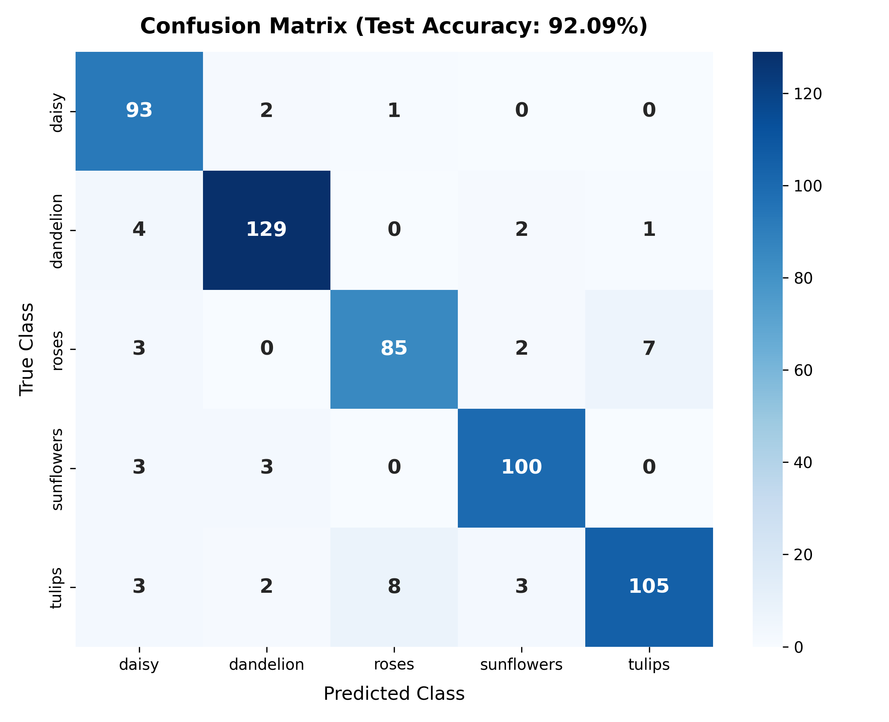
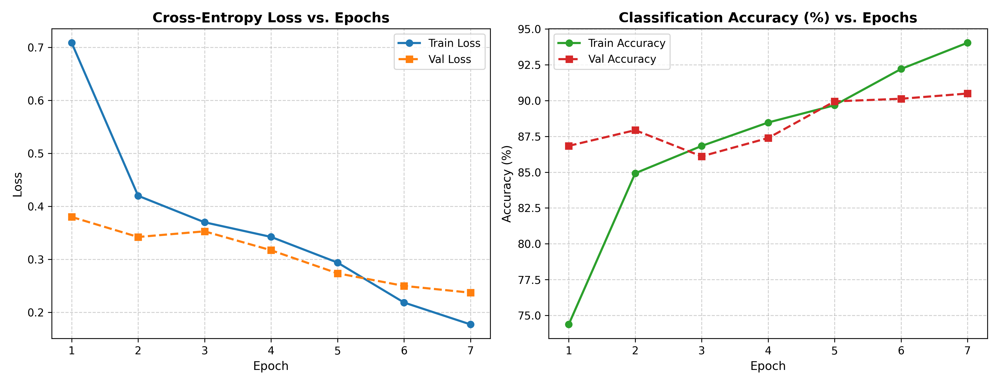

# 🌸 Image Classifier with Transfer Learning

[](https://www.python.org/)
[](https://pytorch.org/)
[](https://streamlit.io/)
[](https://pytorch.org/vision/stable/models.html)
[]()
[](LICENSE)

An end-to-end deep learning image classification system built with **PyTorch** using **Transfer Learning** on a pretrained **MobileNetV2** backbone. The classifier identifies 5 distinct flower species with **92.09% test accuracy**, accompanied by an interactive **Streamlit** web application, CLI inference tools, automated dataset splitting with data augmentation, full evaluation reports, and an interactive Jupyter Notebook.

---

## 🌟 Key Features

- **Pretrained Architecture**: Leverages ImageNet-pretrained **MobileNetV2** with depthwise separable convolutions for high accuracy and parameter efficiency (~3.5M parameters, 10.45 MB weights).
- **Two-Stage Transfer Learning**:
  - *Stage 1 (Feature Extraction)*: Frozen backbone warmup to train the customized MLP classifier head ($lr = 10^{-3}$).
  - *Stage 2 (Differential Fine-Tuning)*: Top convolutional blocks unfrozen with Cosine Annealing learning rate schedule ($lr = 10^{-4} \to 10^{-6}$).
- **Data Augmentation**: Real-time geometric and photometric transforms (`RandomResizedCrop`, `RandomRotation`, `RandomHorizontalFlip`, `ColorJitter`) to improve robustness and prevent overfitting.
- **High Performance**: **92.09% Overall Test Accuracy** and **0.9206 Weighted F1-Score** evaluated on 556 held-out test images.
- **Interactive Streamlit Web Interface**: Complete frontend with image drag-and-drop, sample selectors, live confidence bar charts, confusion matrix viewer, and methodology docs.
- **CLI Inference**: Command-line prediction tool (`src/predict.py`) for rapid single-image classification.
- **Modular Codebase**: Clean, decoupled structure adhering to software engineering best practices.

---

## 📊 Dataset & Class Distribution

The dataset is sourced from the [Google / TensorFlow Flower Photos Benchmark](https://storage.googleapis.com/download.tensorflow.org/example_images/flower_photos.tgz). It contains **3,670 natural images** partitioned into stratified **Train (70%)**, **Validation (15%)**, and **Test (15%)** splits using a reproducible seed (`seed=42`).

| Class Name | Total Images | Train Set (70%) | Validation Set (15%) | Test Set (15%) |
| :--- | :---: | :---: | :---: | :---: |
| **Daisy** 🌼 | 633 | 443 | 94 | 96 |
| **Dandelion** 🌾 | 898 | 628 | 134 | 136 |
| **Roses** 🌹 | 641 | 448 | 96 | 97 |
| **Sunflowers** 🌻 | 699 | 489 | 104 | 106 |
| **Tulips** 🌷 | 799 | 559 | 119 | 121 |
| **Total** | **3,670** | **2,567** | **547** | **556** |

---

## 📈 Evaluation & Benchmark Results

### Overall Metrics on Held-Out Test Split (556 Unseen Images)
- **Test Accuracy**: **92.09%**
- **Test Cross-Entropy Loss**: **0.2264**
- **Macro Average F1-Score**: **0.9192**
- **Weighted Average F1-Score**: **0.9206**

### Per-Class Classification Report

| Class | Precision | Recall | F1-Score | Support |
| :--- | :---: | :---: | :---: | :---: |
| **Daisy** | 0.8774 | **0.9688** | 0.9208 | 96 |
| **Dandelion** | **0.9485** | 0.9485 | **0.9485** | 136 |
| **Roses** | 0.9043 | 0.8763 | 0.8901 | 97 |
| **Sunflowers** | 0.9346 | 0.9434 | 0.9390 | 106 |
| **Tulips** | 0.9292 | 0.8678 | 0.8974 | 121 |

### Confusion Matrix
<p align="center">
  
</p>

### Training & Validation Learning Curves
<p align="center">
  
</p>

---

## 📁 Repository Structure

```
Image-Classifier-with-Transfer-Learning/
├── app.py                           # Interactive Streamlit frontend dashboard
├── requirements.txt                 # Python dependencies
├── README.md                        # Project documentation
├── .gitignore                       # Git ignore configurations
├── models/
│   ├── __init__.py                  # Model exports
│   ├── classifier.py                # MobileNetV2/ResNet18 architecture and checkpoint loader
│   └── best_model.pth               # Saved PyTorch checkpoint weights (10.45 MB)
├── src/
│   ├── __init__.py
│   ├── dataset.py                   # Dataset splitting, augmentation transforms, and DataLoaders
│   ├── train.py                     # Two-stage transfer learning training script
│   ├── evaluate.py                  # Test evaluation, metrics, and confusion matrix generator
│   └── predict.py                   # Single image CLI prediction script
├── notebooks/
│   └── transfer_learning_classifier.ipynb # End-to-end interactive Jupyter Notebook
├── reports/
│   ├── report.md                    # Detailed academic & engineering project report
│   ├── evaluation_results.json      # Raw test evaluation metrics
│   ├── training_history.json        # Epoch-by-epoch loss and accuracy metrics
│   ├── confusion_matrix.png         # High-resolution confusion matrix heatmap
│   └── training_curves.png          # High-resolution loss and accuracy curves
└── sample_images/                   # Curated test images for each class
    ├── daisy.jpg
    ├── dandelion.jpg
    ├── roses.jpg
    ├── sunflowers.jpg
    └── tulips.jpg
```

---

## 🚀 Quick Start Guide

### 1. Clone the Repository
```bash
git clone https://github.com/Sadiraja/Image-Classifier-with-Transfer-Learning.git
cd Image-Classifier-with-Transfer-Learning
```

### 2. Set Up Virtual Environment & Install Dependencies
```bash
python -m venv venv
# On Windows:
venv\Scripts\activate
# On Linux/macOS:
source venv/bin/activate

pip install -r requirements.txt
```

---

## 🖥️ Running the Streamlit Web Application

Launch the interactive web application locally:
```bash
streamlit run app.py
```
Open your browser at `http://localhost:8501`.

**Features in Web App:**
1. **Interactive Predictions**: Upload your own image or choose from preset sample images.
2. **Confidence Breakdown**: View the top predicted flower and horizontal probability distribution bar chart.
3. **Analytics Explorer**: Inspect the normalized confusion matrix, training learning curves, and full classification report.
4. **Methodology Tab**: In-depth explanation of transfer learning, data augmentations, and model limitations.

---

## ⌨️ CLI Image Prediction

To predict the class of an image from the terminal:
```bash
python src/predict.py sample_images/roses.jpg
```

**Example Output:**
```text
Analyzing image: sample_images/roses.jpg

Predictions:
-----------------------------------
 1. Roses        : 100.00%
 2. Tulips       :   0.00%
 3. Daisy        :   0.00%
 4. Dandelion    :   0.00%
 5. Sunflowers   :   0.00%
-----------------------------------
```

You can also specify custom checkpoints or the number of top predictions:
```bash
python src/predict.py path/to/your/image.jpg --top_k 3 --model models/best_model.pth
```

---

## 🔄 Retraining & Evaluation

If you wish to re-split the dataset or train the model from scratch:

### 1. Prepare Dataset Splits
```bash
python src/dataset.py
```

### 2. Train the Model
```bash
python src/train.py
```

### 3. Evaluate on the Test Set
```bash
python src/evaluate.py
```

---

## 📓 Interactive Jupyter Notebook

An interactive notebook covering the entire pipeline (data augmentation, model architecture, training curves, confusion matrix, and single-image testing) is available at:
```bash
jupyter notebook notebooks/transfer_learning_classifier.ipynb
```

---

## ⚠️ Limitations & Failure Modes

1. **Visual Overlap (Roses vs. Tulips)**: Red roses and tightly closed red tulips share morphological and chromatic similarities, accounting for the primary inter-class error (~7% mutual misclassification).
2. **Multi-Flower Environments**: The classifier is optimized for single-dominant-subject images. An image containing a bouquet of mixed flowers will predict only the single most dominant class.
3. **Out-of-Distribution (OOD) Images**: When presented with non-flower images (e.g., animals, vehicles), the model will still force a prediction across the 5 flower classes with high pseudo-confidence. Implementing an open-set confidence threshold is recommended for deployment in unconstrained environments.

---

## 📄 License
This project is licensed under the MIT License - see the [LICENSE](LICENSE) file for details.

## 👤 Author
- **Sadiraja** - [GitHub Profile](https://github.com/Sadiraja)
